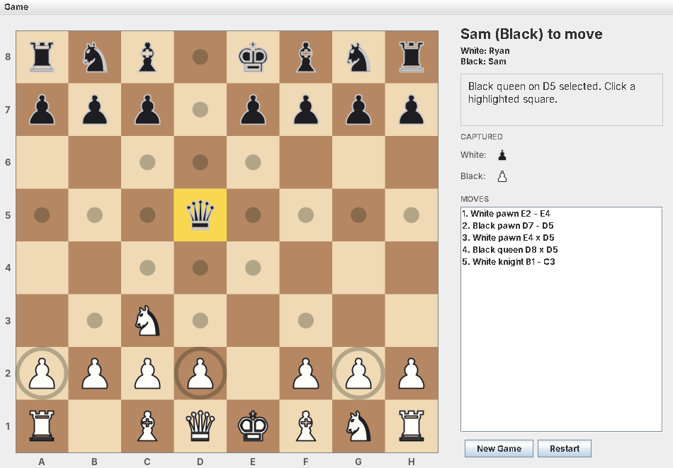

# Chess GUI

**CS3354 Object-Oriented Programming – Project Phase 2**
**Team:** Ryan Ashworth

A chess game with a Java Swing interface and the full rules of chess, built on the back end from my Phase 1 console chess game. Play against another person on the same computer, or against the computer at three difficulty levels. The game rules live in the back end, so the GUI and the original console version run on the same classes.



---

## Requirements

- **Java 17 or newer** (developed and tested with OpenJDK 26)
- The game uses only the Java standard library (Swing, `java.util.logging`)
- The unit tests use **JUnit 4.13.2** and **Hamcrest Core 1.3**, both included in `lib/`, so there is nothing to download

## Entry points

| Program | Main class |
|---|---|
| Swing GUI (Phase 2) | `chess.gui.ChessGuiApp` |
| Console version (Phase 1) | `chess.console.ChessApp` |

## How to run

### In IntelliJ IDEA

1. Open the `console-chess` folder as a project.
2. Open `src/chess/gui/ChessGuiApp.java`.
3. Click the green run button **in the left margin next to `main`** and choose **Run 'ChessGuiApp.main()'**.

The toolbar's run button repeats the last thing you ran. If it runs the tests instead of the game, use the dropdown next to it and pick **ChessGuiApp**.

### From the command line

From the project folder:

```bash
javac -d out $(find src -name "*.java")
java -cp out chess.gui.ChessGuiApp
```

To run the console version instead:

```bash
java -cp out chess.console.ChessApp
```

## How to play

1. The game opens with you as White against the computer at Medium. Use **New Game** to choose:
   - **Play the computer:** your name, your color (White or Black) and the difficulty (Easy, Medium or Hard)
   - **Two players, one screen:** a name for each player
2. **Click one of your pieces.** Its square turns yellow, a dot marks each empty square it can move to, and a ring marks each piece it can capture.
3. **Click a highlighted square** to move there. Click the selected piece again to put it down, or click another of your pieces to switch.
4. **Castling:** click your king, then the square two to the left or right.
5. **En passant:** right after an enemy pawn moves two squares to land beside your pawn, capture it as if it had moved one.
6. **Promotion:** move a pawn to the last row and choose a queen, rook, bishop or knight.
7. A king in check is shown on a **red square**. The game ends with a message box on **checkmate** (a win) or **stalemate** (a draw).
8. **Restart** starts the same kind of game again. **Game → Exit** closes the program after asking.

The side panel shows whose turn it is, a status line (red for a rejected move, orange for check, blue for the result), each side's captured pieces, and a numbered move list in the same wording as the Phase 1 history (`1. White pawn E2 - E4`).

## Completed features

- 8 × 8 board with A–H and 1–8 coordinates, Unicode chess pieces and a turn indicator
- Click-to-move with the selected square highlighted and every legal destination shown
- All moves checked in the back end: piece ownership, movement rules, blocked paths, captures and **king safety** (no move may leave your own king in check)
- An invalid move leaves the board and turn unchanged, and the status line explains why
- **Castling**, **en passant**, and **pawn promotion** with a choice of piece
- **Check** shown on the board; **checkmate** and **stalemate** detected, announced, and play stops
- Captured pieces and a move list in the side panel
- New Game (two players, or against the computer as White or Black), Restart and Exit with confirmation
- The Phase 1 console version still works and now uses the full rules too

## Extra-credit features

### 1. AI opponent

**How to use it:** click **New Game**, choose **Play the computer**, pick your color and a difficulty, and click **Start**. If you play Black, the computer makes the first move.

| Level | How it chooses a move |
|---|---|
| Easy | A random legal move |
| Medium | Looks 1 move ahead: takes the move that leaves it best off right away |
| Hard | Looks 3 moves ahead with **minimax** and **alpha-beta pruning** |

Medium and Hard score a position by material (pawn 100, knight 320, bishop 330, rook 500, queen 900) plus small bonuses for good squares, such as knights in the center.

**Handling bad output:** every level is wrapped in `SafeMoveSelector`. If the AI throws an error, returns no move, or returns an illegal move, the game logs a warning and plays a random legal move instead. The unit tests `fallbackWhenStrategyThrows` and `fallbackWhenStrategyCheats` in `AiTest` prove this with deliberately broken strategies.

**How to test it:** play as Black on Hard and the computer opens as White. On Medium, leave a piece where it can be taken for free and the computer takes it. Each AI move and its time appear in `logs/chess.log`.

### 2. Logging and unit tests

**Logging.** Every run writes to `logs/chess.log` in the project folder, using Java's built-in `java.util.logging`. The file is created automatically, and each run adds to the end of it. It records game start and settings, every move, every rejected move with the reason, each AI move with how long it took, and the result. For example:

```
2026-11-11 16:46:59 INFO    Medium (1 move ahead) (Black) chose e7-e5 in 6 ms
2026-11-11 16:46:59 INFO    Move 16: Black e7-e5
2026-11-11 16:47:23 INFO    New game started.
2026-11-11 16:47:23 INFO    Settings: You vs Player 2
```

`logs/` is listed in `.gitignore`, so log files are not committed.

**Unit tests.** 50 JUnit 4 tests in the `test/` folder:

| Test class | What it checks |
|---|---|
| `ChessRulesTest` | Legal moves at the start, pins, moving into and out of check, castling allowed and blocked, en passant and its one-move limit, promotion, checkmate (F2-F3, E7-E5, G2-G4, D8-H4), stalemate |
| `GameTest` | A message for every kind of invalid move, corner squares, listener events, restart, the Phase 1-style move history |
| `AiTest` | Every level plays legal moves, Medium takes a free queen, Hard avoids a defended piece and finds a checkmate, the fallback for broken strategies |
| `InputParserTest` | Console move formats, promotion letters, bad input |
| `PieceTest` | Each piece's moves, pawn captures, copying pieces, `PieceFactory` |

**To run the tests in IntelliJ:** right-click the `test` folder and choose **Run 'All Tests'**. The `console-chess.iml` file already marks `test/` as a test folder and links the JUnit jars in `lib/`; if IntelliJ asks, reload the project.

**To run the tests from the command line** (from the project folder, after compiling the game as shown above):

```bash
javac -d out/test -cp out:lib/junit-4.13.2.jar:lib/hamcrest-core-1.3.jar $(find test -name "*.java")
java -cp out:out/test:lib/junit-4.13.2.jar:lib/hamcrest-core-1.3.jar org.junit.runner.JUnitCore \
    chess.service.ChessRulesTest chess.service.GameTest chess.ai.AiTest \
    chess.console.InputParserTest chess.pieces.PieceTest
```

The last line of output should be `OK (50 tests)`. On Windows, replace each `:` in the classpath with `;`.

## Suggested moves to try

Use **New Game → Two players, one screen** so you can play both sides.

| Moves | Expected result |
|---|---|
| E2-E4, E7-E5 | Both accepted; the move list shows both |
| E2-E4, D7-D5, E4 takes D5 | Ring around D5; the Black pawn is captured |
| Click A1, then A5 (at the start) | Rejected: "The White rook's path from A1 to A5 is blocked." |
| Click E2, then E5 | Rejected: "A pawn can't move from E2 to E5." |
| E2-E4, E7-E5, F2-F4, D8-H4, then A2-A3 | Check (red king square), then A2-A3 rejected because it doesn't escape check |
| E2-E4, E7-E5, G1-F3, B8-C6, F1-C4, F8-C5, then E1-G1 | Castles kingside; the rook jumps to F1 |
| E2-E4, A7-A6, E4-E5, D7-D5, then E5-D6 | En passant; the pawn on D5 is removed |
| F2-F3, E7-E5, G2-G4, D8-H4 | Checkmate: Black wins |

## Design improvements

The Phase 2 design applies principles and patterns from the class design slides:

- **Simple Factory:** `PieceFactory` is the one place that turns a letter into a piece, replacing four copies of that code.
- **Decorator:** each AI level is wrapped as `LoggingMoveStrategy(SafeMoveSelector(ai))`. One layer logs the move, the other makes sure it is legal.
- **Strategy:** the AI levels share the `MoveStrategy` interface, so the GUI works with any of them.
- **Observer:** `Game` notifies `GameListener`s (the GUI controller and the logger) without depending on either.
- **Single source of truth:** `ChessRules` alone decides which moves are legal, for validation, the move hints, checkmate and stalemate, and the AI.

The project report explains each change and the problem it solved.

## Known limitations

- Draws by threefold repetition, the fifty-move rule and insufficient material are not detected.
- There is no undo, and games can't be saved or loaded.
- White is always shown at the bottom of the board.
- The Hard computer looks only 3 moves ahead, so it can miss longer tactics.
- The unit tests cover the back end; the GUI was tested by hand.

## Project structure

```
src/chess/
├── model/     PieceColor, Position, Player, Move, MoveType, Board        – the game's data
├── pieces/    Piece (abstract) and King, Queen, Rook, Bishop, Knight,
│              Pawn; PromotionPiece, PieceFactory                         – movement and piece creation
├── service/   Game, ChessRules, GameListener, GameStatus, MoveResult     – the rules and the game
├── ai/        MoveStrategy, RandomAI, MinimaxAI, BoardEvaluator,
│              SafeMoveSelector, LoggingMoveStrategy, Difficulty          – the computer opponent
├── logging/   LoggingSetup, GameLogger                                   – the log file
├── gui/       ChessGuiApp, ChessFrame, GameController, BoardPanel,
│              SidePanel, GameSettings, NewGameDialog, PromotionDialog,
│              PieceGlyphs                                                – the Swing interface
└── console/   ChessApp, ConsoleUI, InputParser, Command                  – the Phase 1 text interface
test/chess/    JUnit tests and the TestPositions helper
lib/           JUnit and Hamcrest jars (tests only)
```

The application has 2,946 lines of Java code in 42 classes, not counting blank lines, comments or tests.

## Documentation

- **Javadoc:** open `docs/index.html` in a browser.
- **UML class diagrams:** `uml/phase2-backend.png` (model, pieces, service) and `uml/phase2-frontend.png` (gui, ai, logging, console), with Mermaid sources in the matching `.mmd` files. The Phase 1 diagram is kept as `uml/class-diagram.png`.
